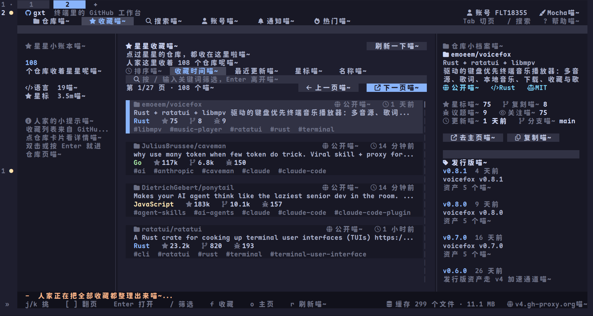

<div align="center">

# 🐾 gitx-tui (`gxt`)

**终端里的 GitHub 工作台和本地 git TUI**<br>
*使用 Rust、ratatui 与 crossterm 写成喵~*

[](https://www.rust-lang.org/)
[](https://ratatui.rs/)
[](LICENSE)
[](https://catppuccin.com/)

[](https://github.com/FLT18355/gitx-tui)
[](https://github.com/FLT18355/gitx-tui)

</div>

---

## 📸 预览

<div align="center">
  
</div>

---

## ✨ 关于

**`gitx-tui`** 是你在终端里的 GitHub 工作台与本地 Git 管理器。
GitHub 侧覆盖仓库、收藏、搜索、账号额度、仓库详情和 Actions；本地侧用 lazygit 风格查看改动、diff、分支、提交和标签，并支持暂存、提交、推送、拉取等全套操作。

界面全面使用 **Catppuccin 配色** 与 **Nerd Font 图标**，拒绝乱码，只留极客美学，没有 emoji 喵~

## 🚀 功能特性

<details>
<summary><b>🌐 GitHub 工作区 (点击展开)</b></summary>

- **仓库与搜索**：账号仓库、收藏、搜索、语言筛选、排序、分页和仓库详情。
- **热门页**：按今日、本周、本月看 GitHub 上涨星最快的仓库，支持结果筛选和语言筛选。
- **筛选增强**：`/` 在当前列表里按名称、简介、语言和主题筛选；搜索结果支持二次筛选、语言筛选和三种排序，搜索历史可直接点选。
- **用户主页**：点仓库作者进入，查看作者资料和全部公开仓库，并可继续打开仓库。
- **仓库操作**：
  - **Fork**：仓库页按 `Y` 打开 Fork 小窗口，确认后把别人的仓库 Fork 到自己账号。
  - **删除**：自己的仓库按 `D` 打开确认窗口，确认后从 GitHub 删除。
  - **编辑**：自己的仓库可改名称、简介、主页、主题、可见性、归档，以及 Issues / Discussions / Wiki 开关。
- **仓库详情**：文件树（目录优先、树形连接线、右对齐文件大小）、README 渲染（标题、列表、代码块、表格，支持 `F` 全屏），按 `L` 查看语言占比统计。
- **提交与分支**：仓库页按 `C` 打开提交页；右侧显示本次提交改动的文件与增删行数；按 `b` 选分支，文件树、README 和提交列表跟着切换。
- **发行版 (Releases)**：右侧按钮支持关键词搜索，查看说明并逐个下载文件或源码包。运行 `gxt release` 可打开独立 TUI 直接发布个人发行版，并可在发布时附带本地文件上传。
- **议题与 PR**：列表、状态筛选、类型筛选、正文预览和标签；议题页按 `n` 直接新建议题。
- **通知与 Actions**：未读/全部通知、标单条已读；查看 Actions 运行记录、jobs、steps 及手动触发。
- **账号页**：资料、仓库统计、GitHub API core/search/GraphQL 额度与恢复时间。

</details>

<details>
<summary><b>💻 本地仓库 TUI (点击展开)</b></summary>

- **多面板视图**：分支、标签、改动、提交、stash 五个列表，支持分页和选择。
- **差异预览**：选中文件、提交、分支、标签或 stash 时显示对应差异。
- **暂存区管理**：暂存、取消暂存、全部暂存、全部取消暂存。
- **提交与标签**：提交、创建标签、推送当前分支、推送标签、fetch、pull。
- **分支操作**：切换分支、合并、变基、删除选中分支，`Q` 中止进行中的合并或变基。
- **Stash**：保存、恢复、应用和删除。
- **导航与输入**：顶部页签导航（`Tab` 循环、`1`~`6` 直达），底部快捷键随面板变化且支持鼠标点击；支持中文输入、横向滚动和显示宽度正确的光标。

</details>

<details>
<summary><b>⚙️ 全局与体验 (点击展开)</b></summary>

- **设置 TUI**：主题、预览开关、下载目录、代理、缓存时间和缓存管理集中在一页。
- **主题系统**：内置 Latte、Frappe、Macchiato、Mocha 四套 Catppuccin 配色。
- **缓存机制**：仓库、收藏、搜索、详情、Actions 等数据自动落盘并按 TTL 刷新。
- **网络代理**：公开 API 可走加速代理，认证请求直连 GitHub，保证安全。

</details>

---

## 📦 环境与安装

**环境要求：**
- Rust 2024 / 1.88 或更新版本（从源码构建时）
- GitHub CLI `gh`（用于读取登录凭据）
- 支持鼠标与真彩色的终端
- 推荐安装 Nerd Font；没有时图标可能显示成方块

**构建源码：**
```bash
git clone https://github.com/FLT18355/gitx-tui.git
cd gitx-tui
cargo build --release
./target/release/gxt
```

---

📖 文档导航

· CLI 用法：运行 gxt -h，或看 docs/CLI.md
· 按键操作：看 docs/KEYBINDINGS.md
· 配置与网络：看 docs/CONFIG.md
· 构建与架构：看 docs/DEVELOPMENT.md

---

<div align="center">
  <sub>用 ❤️ 和 ☕ 以及猫猫能量驱动</sub>
</div>