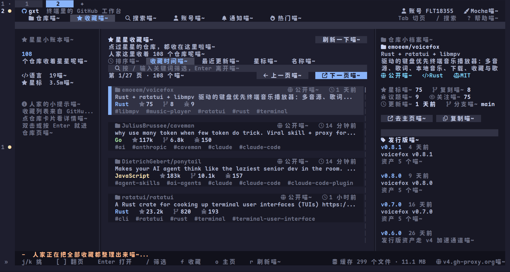

<div align="center">

# 🐾 gitx-tui (`gxt`)

**终端里的 GitHub 工作台**<br>
*使用 Rust、ratatui 与 crossterm 写成喵~*

[](https://www.rust-lang.org/)
[](https://ratatui.rs/)
[](LICENSE)
[](https://catppuccin.com/)

[](https://github.com/FLT18355/gitx-tui)
[](https://github.com/FLT18355/gitx-tui)

</div>

---

## 📸 预览

<div align="center">
  
</div>

---

## ✨ 关于

**`gitx-tui`** 是你在终端里的 GitHub 工作台。
GitHub 侧覆盖仓库、收藏、搜索、账号额度、仓库详情和 Actions。

界面全面使用 **Catppuccin 配色** 与 **Nerd Font 图标**，拒绝乱码，只留极客美学，没有 emoji 喵~

## 🚀 功能特性

<details>
<summary><b>🌐 GitHub 工作区 (点击展开)</b></summary>

- **仓库与搜索**：账号仓库、收藏、搜索、语言筛选、排序、分页和仓库详情。
- **热门页**：按今日、本周、本月看 GitHub 上涨星最快的仓库，支持结果筛选和语言筛选。
- **筛选增强**：`/` 在当前列表里按名称、简介、语言和主题筛选；搜索结果支持二次筛选、语言筛选和三种排序，搜索历史可直接点选。
- **用户主页**：点仓库作者进入，查看作者资料和全部公开仓库，并可继续打开仓库。
- **仓库操作**：
  - **Fork**：仓库页按 `Y` 打开 Fork 小窗口，确认后把别人的仓库 Fork 到自己账号。
  - **删除**：自己的仓库按 `D` 打开确认窗口，确认后从 GitHub 删除。
  - **编辑**：自己的仓库可改名称、简介、主页、主题、可见性、归档，以及 Issues / Discussions / Wiki / Projects / 模板、合并方式、自动合并、删分支、更新分支、签名提交等开关。
- **仓库详情**：文件树（根目录起步，点文件夹进入、点文件预览、`..` 返回上级、悬停高亮、文件大小右对齐）、README 渲染（标题、列表、代码块、表格，支持 `F` 全屏），按 `L` 查看语言占比统计。
- **提交与分支**：仓库页按 `C` 打开提交页；右侧显示本次提交改动的文件与增删行数；按 `b` 选分支，文件树、README 和提交列表跟着切换。
- **发行版 (Releases)**：右侧按钮支持关键词搜索，查看说明并逐个下载文件或源码包；`y` 复制选中文件下载链接。自己的仓库按 `n`（或点「发布喵~」）在主 TUI 里直接发布：标签、标题、目标分支、发行说明、附件、草稿、预发布、自动说明和标记最新都能设置。
- **列表筛选**：议题页和提交页按 `/` 按关键词筛选标题、作者、标签或提交信息。
- **工作流控制**：Actions 页按 `R` 重跑已完成运行，按 `X` 取消进行中的运行（带确认弹窗）。
- **复制快捷操作**：`y` 克隆地址、`u` SSH 地址、`N` 仓库全名；发行版文件链接也能一键复制。
- **克隆与最近访问**：仓库页按 `Ctrl+G` 或点「克隆」按钮，走加速通道把仓库克隆到设置里的克隆目录；打开过的仓库会记在首页「最近访问」里，`j/k` 选中后 `Enter` 直接回到仓库页。
- **议题与 PR**：列表、状态筛选、类型筛选、正文预览和标签；`Enter` 进入详情页，可看完整正文与评论线程、发评论、开关议题；合并请求可确认 squash 合并。议题页按 `n` 直接新建议题。
- **议题详情页**：标题、正文、标签、评论线程和 PR 改动文件同屏展示；`c` 写评论，`Ctrl+S` 发送，`x` 关闭 / 重新打开，`M` 合并 PR，`o` 打开浏览器。
- **Gist 工作台**：`7` 打开自己的 Gist 列表，右侧预览文件内容（Markdown 渲染、代码高亮和行号）；`n` 新建、`D` 删除、`Tab` 切换文件、`y` 复制地址，列表会缓存，详情按需读取。
- **分支对比与建 PR**：仓库页按 `m` 进入对比页，`b` 分别挑 base / head，查看领先 / 落后提交数和文件 diff；`v` 在提交和文件视图间切换，`n` 填标题 / 正文 / 草稿后直接创建合并请求。
- **文件预览**：仓库树里按 `Enter` 直接读文件内容，支持行号、语法着色、自动换行、横向滚动、复制路径、下载原件和跳浏览器。
- **社交网络**：账号页或用户主页按 `n` 查看粉丝 / 关注 / 组织三个列表，列表会补全每个人的粉丝 / 关注 / 仓库数和简介；`f` 关注或取关（会先查当前关系），用户主页里按 `f` 也能直接关注作者，`Enter` 继续打开用户主页。
- **标签页 (Tags)**：仓库页按 `v` 查看全部 git tag、指向的提交和源码包；支持打开标签树、复制标签名、下载 zip / tar.gz。
- **通知与 Actions**：未读/全部通知、标单条已读；查看 Actions 运行记录、jobs、steps 及手动触发。
- **账号页**：资料、仓库统计、GitHub API core/search/GraphQL 额度与恢复时间。

</details>

<details>
<summary><b>📝 Markdown 预览器 (点击展开)</b></summary>

- **扫描目录**：`gxt md [目录或文件]` 递归读取当前目录和子目录里的 `.md` / `.markdown` / `.mdx`，自动跳过 `.git`、`target`、`node_modules` 等目录。
- **实时预览**：左侧挑文件，右侧直接渲染标题、列表、代码块、表格和引用；`Enter` 打开并进入预览。
- **富文本渲染**：粗体 / 斜体 / 行内代码 / 链接 / 删除线、任务清单勾选框和完成进度条、`[!NOTE]` 等提示块、带语言标签和语法高亮的全宽代码卡片、表格表头高亮与斑马纹；图片显示为带图标的 `图片 路径` 标签，shields 徽章自动隐藏。
- **文档搜索**：`Ctrl+F` 搜当前文档，`Enter` 确认，`n` / `N` 跳下一处 / 上一处，命中文字高亮，`Esc` 清掉搜索。
- **大纲跳转**：`Tab` 切到大纲，按标题层级挑，`Enter` 跳到对应段落。
- **阅读增强**：`m` 切源码，`F` 全屏，`g/G` 首尾，`PgUp/PgDn` 翻页，标题栏显示阅读进度。
- **筛选与排序**：`/` 按路径筛选，`s` 按路径 / 大小 / 修改时间排序。
- **主题与编辑**：`t` 循环 Catppuccin 主题并写入配置，`e` 用 `$VISUAL` / `$EDITOR` 编辑当前文件。
- **鼠标**：文件行、大纲行、页签、筛选栏、搜索栏和帮助按钮都有悬停高亮；点行选中，滚轮滚列表或预览。
- **视觉统一**：顶部文件 / 大纲 / 预览页签、分区细线、阅读进度条、会话计时和彩色 Nerd Font 图标，和主 TUI 同一套风格。

</details>

<details>
<summary><b>⚙️ 全局与体验 (点击展开)</b></summary>

- **设置 TUI**：主题、预览开关、下载目录、代理、缓存时间、默认启动页和缓存管理集中在一页。
- **首页总览**：默认启动页，也可在设置里换成仓库 / 收藏 / 搜索 / 热门 / 账号 / 通知 / Gist / 洞察；首页看仓库、收藏、未读、缓存统计、置顶仓库、快捷入口和语言分布。
- **通知预热**：启动时读取通知缓存并后台刷新，首页未读数不用先进通知页也能看到。
- **命令面板**：`Ctrl+K` 或 `:` 打开，输入页面或动作名就能跳转、刷新、换主题、管理缓存。
- **置顶仓库**：在仓库列表或仓库页按 `P` 钉住，首页按 `j/k` 挑选、`Enter` 打开，配置自动保存。
- **数据洞察**：`9` 或 `I` 查看语言分布、星标排行、通知与缓存小账本、GitHub API 额度条。
- **主题工作室**：`T` 打开配色面板，预览色块并用 `Enter` 立即切换 Catppuccin 主题。
- **随机探索**：`E` 从当前列表或收藏里随机打开一个仓库，专治选择困难喵~
- **主题系统**：内置 Latte、Frappe、Macchiato、Mocha、Violet 五套 Catppuccin 配色，主题工作室可预览色块。
- **界面细节**：品牌标题、页签和按钮悬停、加载文字脉冲、进度条、未读徽章、圆角统计卡、会话计时、猫咪空状态，以及按语义着色的全站 Nerd Font 图标。
- **统一条形图**：语言占比和账号 API 额度都使用首页同款图标 + 进度条。
- **发行版标签**：tag 使用彩底圆角标签，最新、预发布、草稿各有独立徽章。
- **缓存机制**：仓库、收藏、搜索、详情、Actions 等数据自动落盘并按 TTL 刷新。
- **网络代理**：公开 API 可走加速代理，认证请求直连 GitHub，保证安全。

</details>

---

## 📦 环境与安装

**环境要求：**
- Rust 2024 / 1.88 或更新版本（从源码构建时）
- GitHub CLI `gh`（用于读取登录凭据）
- 支持鼠标与真彩色的终端
- 推荐安装 Nerd Font；没有时图标可能显示成方块

**构建源码：**
```bash
git clone https://github.com/FLT18355/gitx-tui.git
cd gitx-tui
cargo build --release
./target/release/gxt
```

---

📖 文档导航

· CLI 用法：运行 gxt -h，或看 docs/CLI.md
· 按键操作：看 docs/KEYBINDINGS.md
· 配置与网络：看 docs/CONFIG.md
· 构建与架构：看 docs/DEVELOPMENT.md

---

<div align="center">
  <sub>用 ❤️ 和 ☕ 以及猫猫能量驱动</sub>
</div>